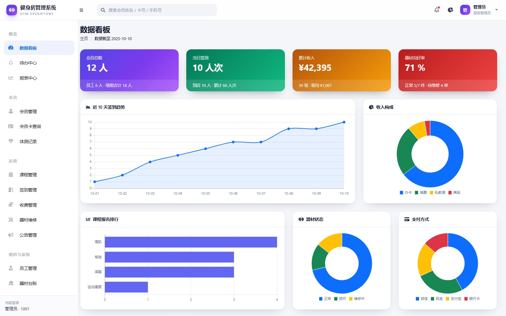
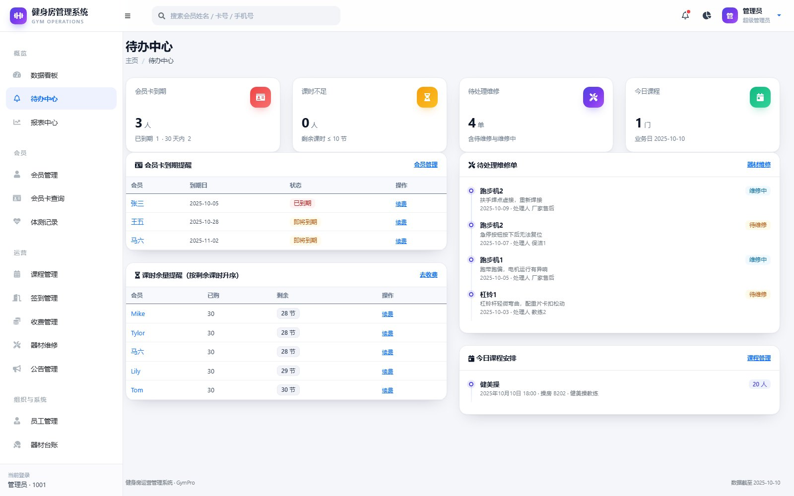
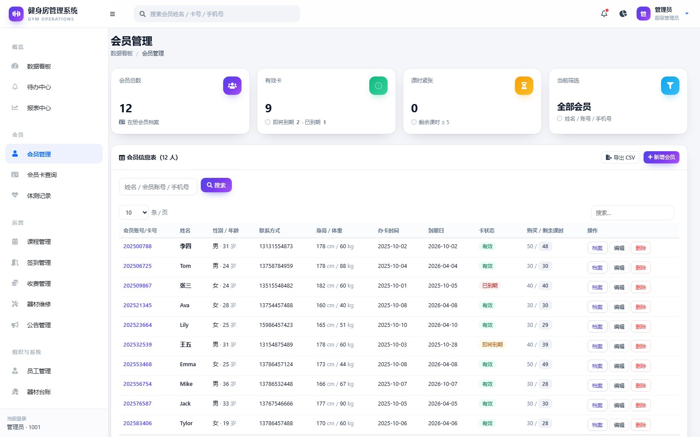
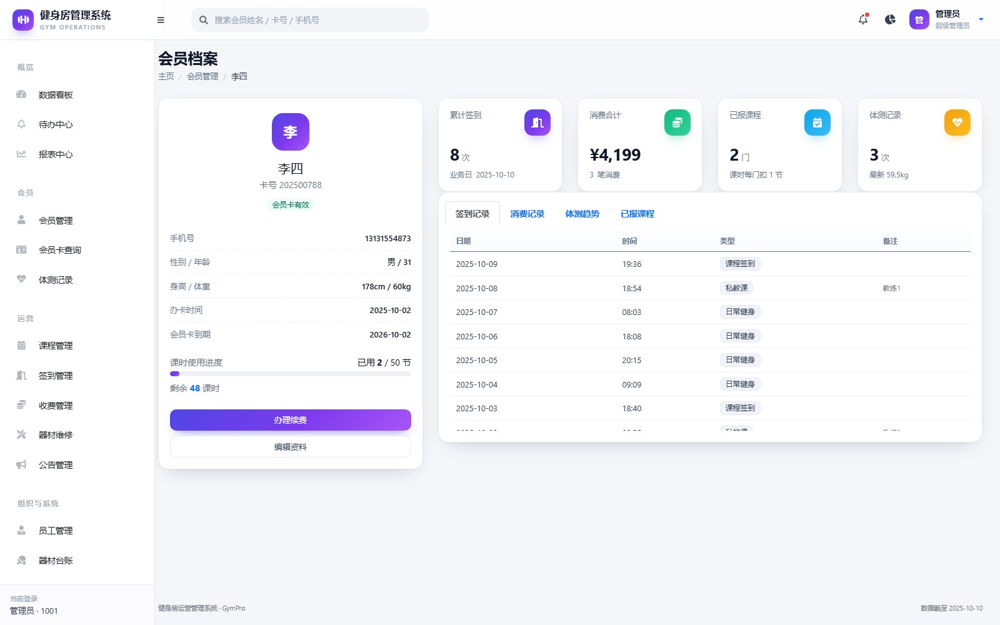
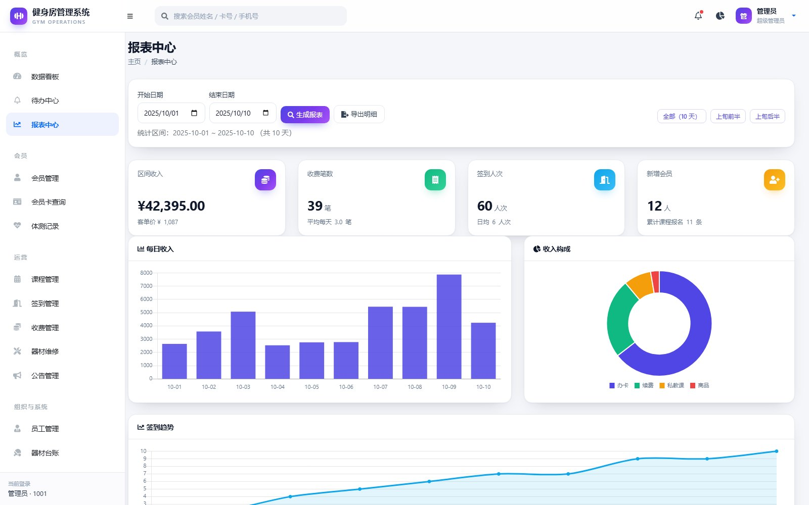
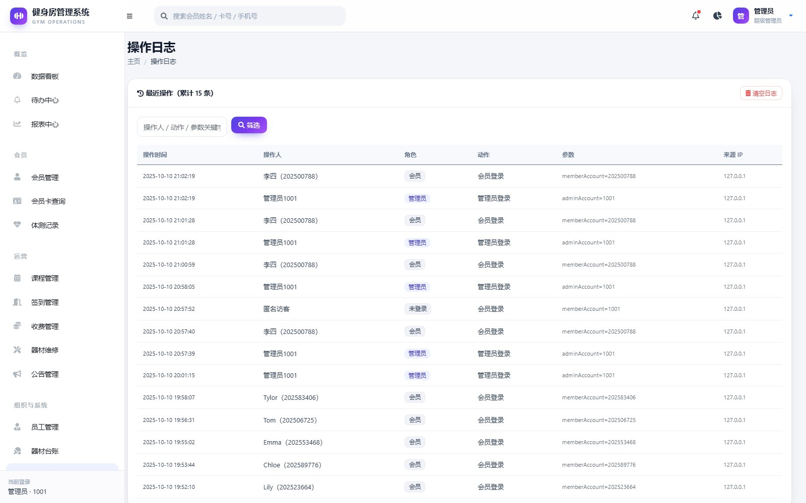
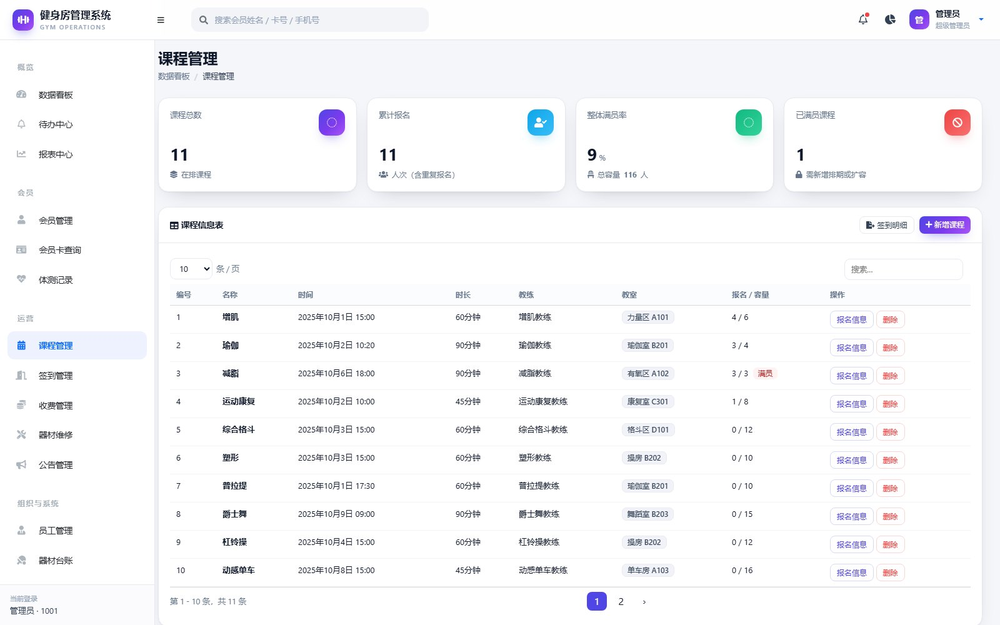
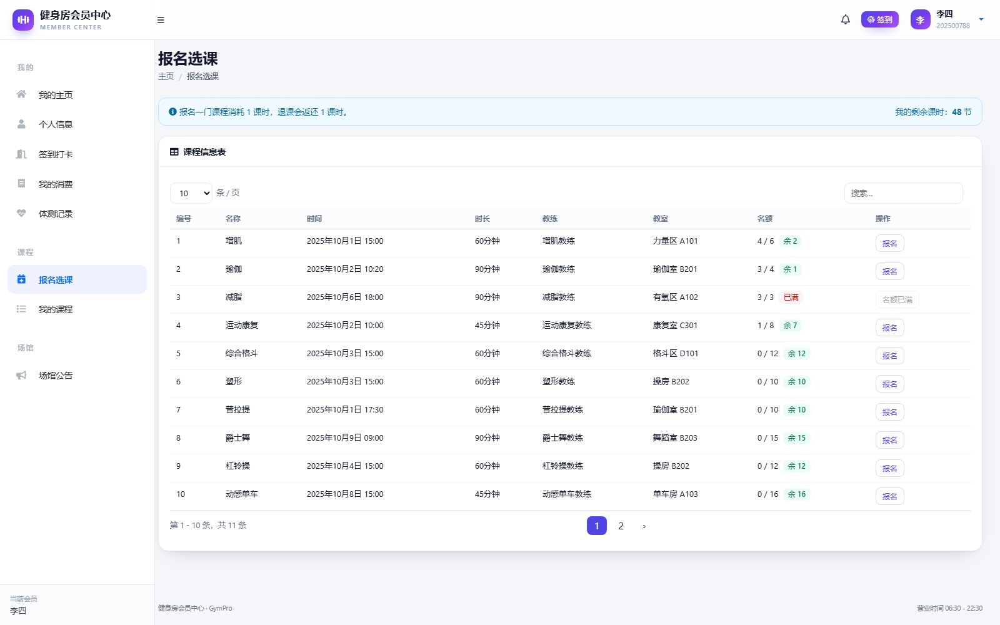

# 小区健身房管理系统

> 面向社区小型健身房的会员与运营管理系统：会员建档、课程排期、自助约课、签到、收费、器材报修、体测与经营报表，一套系统覆盖门店日常运营的主要环节。


系统分为**管理员端**与**会员端**两套界面，共 24 个功能页面，围绕「人、课、钱、器」四条主线：会员与员工档案、课程与报名、签到与收费、器材台账与维修，以及在此基础上汇总的经营报表。

---

## 界面预览

| 数据看板 | 待办中心 |
|:---:|:---:|
|  |  |

| 会员管理 | 会员档案 360 |
|:---:|:---:|
|  |  |

| 经营报表 | 操作日志 |
|:---:|:---:|
|  |  |

| 课程管理 | 会员端 · 在线约课 |
|:---:|:---:|
|  |  |

---

## 功能特性

### 管理员端

- **数据看板**：会员总数、当日签到、累计收入、器材完好率四张指标卡，配签到趋势、收入构成、课程排行、器材状态、支付方式五张图表，另附课时余量提醒、会员卡到期、最新公告等明细卡片。
- **待办中心**：自动汇总即将到期会员、课时不足会员、待处理维修工单、今日课程四类待办。
- **会员管理**：建档、检索（姓名 / 卡号 / 手机号）、编辑、续费、删除；顶部展示会员总数、有效卡、课时紧张数；支持导出 CSV。
- **会员档案 360**：左侧会员卡，右侧消费、签到、课时、体测四项指标；下方签到、消费、体测、课程四个标签页，体测含 BMI 趋势图。
- **课程管理**：排课、编辑、删除，实时显示报名人数与剩余名额，满员自动拦截报名。
- **签到管理 / 收费管理 / 体测记录**：日常台账式录入与查询，支持多条件筛选。
- **器材台账与维修**：器材状态（正常 / 维修中 / 报废）流转，报修单从登记到完成闭环。
- **公告管理 / 员工管理**：面向会员的通知发布，以及教练与前台员工档案。
- **经营报表**：按日期区间统计收入、报名、签到、新增会员，含指标卡、趋势图、构成图与明细表，一键导出 CSV。
- **操作日志**：拦截器自动记录所有写操作（操作人、角色、动作、地址、参数摘要、IP、时间），可筛选与清空。

### 会员端

- **会员中心**：我的课时、会员卡状态、消费概览与推荐课程。
- **自助签到**：选择签到类型一键签到，当日重复签到自动拦截。
- **在线约课**：浏览可报名课程、查看剩余名额，报名自动扣减 1 课时，满员或课时不足给出明确提示。
- **我的课程**：已报课程列表，支持取消报名并返还课时。
- **消费记录 / 体测记录 / 公告 / 个人信息**：自助查询与修改。

---

## 技术栈

| 层次 | 选型 |
|---|---|
| 后端 | Spring Boot 2.5.3、Spring MVC、拦截器、操作日志切面 |
| 持久层 | MyBatis 2.1.4（注解 + XML 混合） |
| 视图层 | Thymeleaf 3.0、Bootstrap 4、Chart.js 2.8、simple-datatables |
| 数据库 | MySQL 8.0（12 张业务表，InnoDB / utf8） |
| 构建 | Maven 3.6+，JDK 8（兼容 11） |

前端模板基于 SB Admin 2 改造，统一的设计系统（CSS 变量、卡片、表单、表格、时间轴）集中在 `static/css/app.css`。

---

## 快速开始

### 方式一：便携版（推荐，零环境依赖）

从 Releases 下载 `小区健身房管理系统-便携版.zip`（约 113 MB），解压后双击 **启动系统.bat**，浏览器会自动打开 <http://127.0.0.1:8080/>。

便携包内置精简版 MySQL 8.0.28 与 Java 运行时，**无需安装 JDK、MySQL、Maven**；不写注册表、不装系统服务，删除文件夹即彻底卸载。首次启动会自动建库并导入演示数据（约 30 秒）。

### 方式二：源码运行

环境要求：JDK 8 或 11、Maven 3.6+、MySQL 8.0。

```bash
# 1. 建库并导入演示数据
mysql -uroot -p < gym_management_system.sql

# 2. 按需修改数据库连接
#    src/main/resources/application.yml  或  config/application.properties

# 3. 打包并运行
mvn clean package -DskipTests
java -jar target/gym-management-system-0.0.1-SNAPSHOT.jar
```

打开 <http://localhost:8080/> 即可访问。

---

## 默认账号

| 角色 | 账号 | 密码 | 说明 |
|---|---|---|---|
| 管理员 | `1001` | `123456` | 另有 1002、1003 两个备用管理员 |
| 会员 | `202500788` | `123456` | 课时与消费记录最完整，适合演示 |
| 会员 | `202506725` | `123456` | 外籍会员示例 |
| 会员 | `202509867` | `123456` | — |

会员端登录使用 **12 位会员卡号**，不是手机号。演示库共 12 名会员、60 条签到、11 条报名、39 笔收费记录。

---

## 项目结构

```
小区健身房管理系统
├── config/                       # 本地运行覆盖配置（端口、数据源）
├── docs/                         # 使用说明书与界面配图
├── src/main/java/com/milotnt/
│   ├── controller/               # 15 个控制器，覆盖两端全部页面
│   ├── service/ impl/            # 业务层
│   ├── mapper/                   # MyBatis Mapper 接口
│   ├── pojo/                     # 实体类
│   ├── interceptor/              # 登录校验、操作日志拦截器
│   └── common/                   # BusinessClock 等公共组件
├── src/main/resources/
│   ├── templates/                # Thymeleaf 模板（admin / user 两套）
│   ├── static/                   # app.css 设计系统、app.js、Chart.js 配置
│   ├── mybatis/mapper/           # Mapper XML
│   └── application.yml
├── gym_management_system.sql     # 建表 + 演示数据（含 12 张表）
├── enhance_v2/v3/v4.sql          # 增量功能脚本（已合并进主脚本，保留备查）
└── pom.xml
```

---

## 数据库设计

| 表名 | 说明 |
|---|---|
| `admin` | 管理员账号 |
| `member` | 会员档案（卡号、课时、卡有效期、办卡 / 到期日） |
| `employee` | 员工（教练、前台） |
| `class_table` | 课程（名称、时间、教练、容量、教室） |
| `class_order` | 报名记录 |
| `check_in` | 签到记录 |
| `payment` | 收费记录（办卡、续费、私教、商品） |
| `equipment` | 器材台账 |
| `equipment_maintain` | 维修工单 |
| `body_test` | 体测记录（身高、体重、体脂、肌肉量、BMI） |
| `notice` | 公告 |
| `operation_log` | 操作日志 |

---

## 业务规则

- **会员卡状态**：剩余有效期大于 30 天为「有效」，不超过 30 天为「即将到期」，已过期且课时有余为「已到期」。
- **课时**：报名扣减 1 课时，取消报名返还；课时不足时禁止报名。
- **容量**：课程默认容量 20 人，报名人数达到容量后拒绝新报名并提示「名额已满」。
- **签到唯一性**：同一会员同一天只能签到一次。
- **业务日期**：演示数据统一落在 2025 年 10 月上旬（业务日期固定 2025-10-10），便于报表与到期提醒演示完整效果；新增业务按系统真实时间记录。
- **操作日志**：所有写操作经拦截器落库，列名统一转义以兼容 MySQL 8 保留字 `role`。

---

## 文档

- [`docs/软件使用说明书.docx`](docs/软件使用说明书.docx)：10 章、22 张表格，覆盖安装启动、两端逐模块操作、典型业务场景、业务规则、故障排查与附录。
- 另提供《视频图解版说明书》与系统演示视频（2 分 53 秒），见 Releases。

---

## 许可证

本项目基于 [MiloTnT/GymManagementSystem](https://github.com/MiloTnT) 的毕业设计作品二次开发，遵循 MIT License，详见 [LICENSE](LICENSE)。在界面设计、业务模块（报表中心、待办中心、操作日志、会员档案 360）、数据模型与演示数据上做了大量扩展与重构。

如果这个项目对你有帮助，欢迎 Star ⭐
